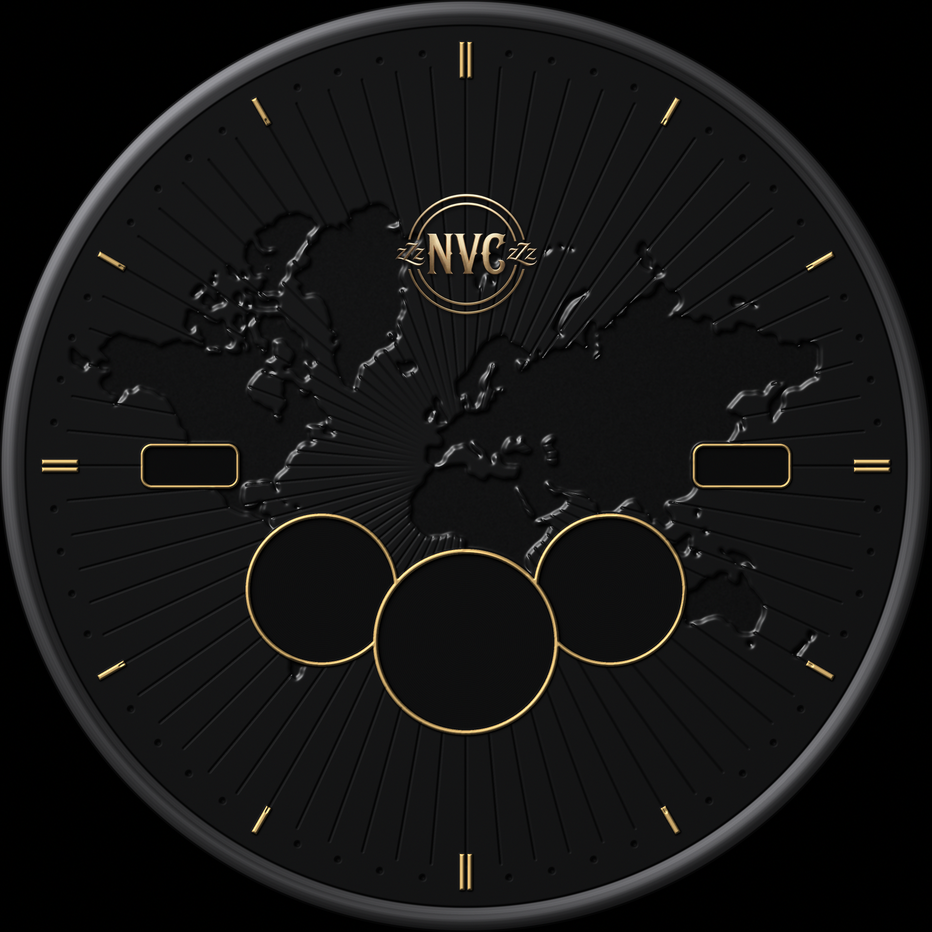

# myNVCWatchFace

Esfera personal para el **OnePlus Watch 3** (Wear OS, Watch Face Format): negra y dorada, con un
mapamundi en bajo relieve, el logo NVC y la glucosa en la sub-esfera central.



## Estado

Diseño cerrado; construcción por empezar.

- Diseño: [`docs/superpowers/specs/2026-11-22-nvc-watchface-design.md`](docs/superpowers/specs/2026-11-22-nvc-watchface-design.md)
- Maqueta interactiva: [`docs/mockup/esfera.html`](docs/mockup/esfera.html)

## Qué muestra

| Zona | Dato |
|---|---|
| Sub-esfera central (la mayor) | glucosa: valor, tendencia, aro según el rango y antigüedad de la lectura |
| Sub-esfera izquierda | atajo a un entrenamiento |
| Sub-esfera derecha | tiempo |
| Ventana de las 3 | día de la semana y del mes |
| Ventana de las 9 | batería |

## Fondo

Se genera con un script, no se dibuja a mano:

```
python -I art/render_bg.py art/data/ne_50m_land.geojson art/src/logo-nvc.jpg art/out bajo
```

Necesita Python 3 con Pillow y numpy. Datos de costa: [Natural Earth](https://www.naturalearthdata.com/), dominio público.
