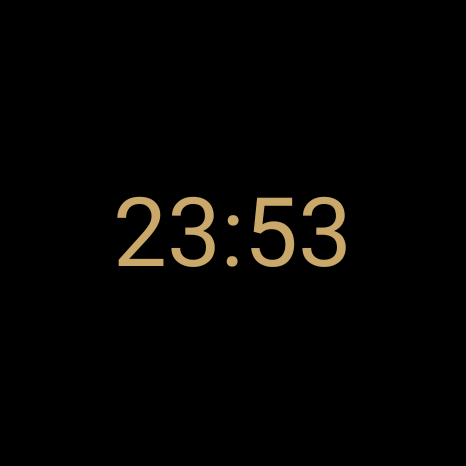

# Prueba 1 · Instalación de una esfera mínima (2026-11-22)

**Resultado: superada.** El OnePlus Watch 3 instala por adb una esfera Watch Face Format propia,
la selecciona por adb y la dibuja. El riesgo nº 1 del diseño queda resuelto.

## Reloj

| Dato | Valor |
|---|---|
| Modelo | `OPWWE251` (OnePlus Watch 3) |
| Compilación | `OPWWE251_11_A.165`, parche de seguridad 2026-08-01 |
| Android / SDK | 14 / **34** → **Wear OS 5.0** |
| Pantalla | 466×466, densidad 320 |
| Motor WFF | `com.google.wear.watchface.runtime` 332919060; en logcat, «DWF renderer 2.0.1» |
| Serial adb | `adb-H631104000081G14004R-e9DEII._adb-tls-connect._tcp.` (con el punto final) |

**Versión de WFF elegida: 2** (la máxima para API 34 según la tabla de
developer.android.com/training/wearables/wff). Manifiesto con
`com.google.wear.watchface.format.version = 2`, `minSdk = 34`.

Hallazgo útil: ya había instalada una esfera WFF de Gluroo (`com.gluroo.watchface.d1`).

## Conexión

1. Depuración inalámbrica en el reloj. El reloj apaga el Wi-Fi con la pantalla apagada o con el
   móvil por Bluetooth: dejarlo con la pantalla de depuración abierta.
2. `adb pair <ip>:<puerto de vincular> <código>` y después el reloj aparece solo por mDNS
   (`adb devices` muestra el serial de arriba). El puerto de conexión cambia; el serial mDNS no.

## Ciclo

```
scripts/watch.sh "adb-H631104000081G14004R-e9DEII._adb-tls-connect._tcp." all 01-minima
```

- Compila con `scripts/build.bat`; valida con `wff-validator.jar` (compilado desde
  `google/watchface`, en `C:\Users\criso\.claude\tools\android\`); instala; selecciona; captura.
- **Selección por adb:** `am broadcast -a com.google.android.wearable.app.DEBUG_SURFACE --es
  operation set-watchface --es watchFaceId com.nvc.watchface.debug`. No está en la documentación
  oficial, pero en este reloj responde `result=1` y la esfera queda puesta.
- Validador: `PASSED … valid against watch face format version #2`.

## Captura



Fondo negro y hora en oro `#C9A86A`, centrada.

## Trampas encontradas

- **AGP 9 mete la biblioteca estándar de Kotlin** (2,4 MB de dex) aunque no haya código. Se quita
  con `kotlin.stdlib.default.dependency=false` en `gradle.properties`. Queda un dex de ~30 KB
  generado por AGP; con `hasCode=false` el reloj lo ignora y carga la esfera.
- **El validador de Google no compila con su Gradle 8.9 sobre el JDK 25** del JBR («Unsupported
  class file major version 69»). Compila con el Gradle 9.7.1 de este proyecto:
  `gradlew -p <repo>/third_party/wff :specification:validator:executable-jar`.
- En `local.properties`, `sdk.dir` necesita las barras dobles (`C\:\\Users\\...`); con barras
  simples Gradle falla con «Invalid file path».

## Pendiente

- Always-On no probado aún (tarea 3).
- Comprobar que la esfera sigue seleccionada tras reiniciar el reloj (tarea 8).
