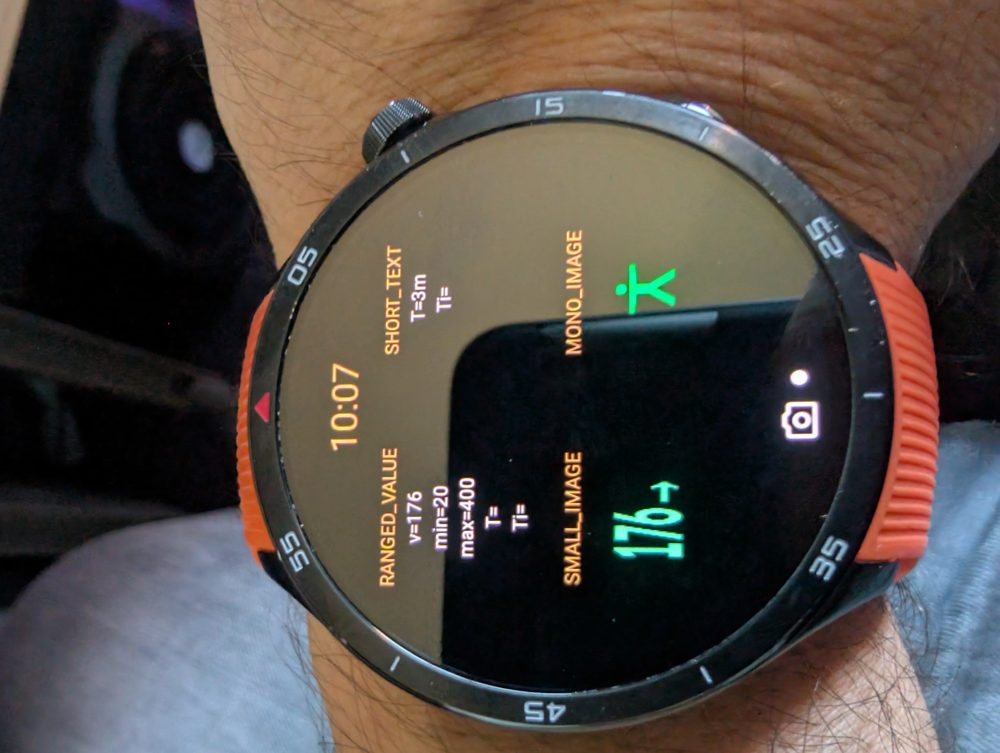

# Prueba 2 · Inspección de complicaciones (2026-11-23)

**Estado: casi cerrada.** Proveedores, tipos y contenido leídos en el reloj (foto del usuario).
Queda el texto exacto de la glucosa en texto de Gluroo (para la flecha) y si la antigüedad se
actualiza sola (ver «Pendiente en el reloj»).

## Contenido real (foto del usuario, 2026-11-23 10:07)

| Hueco | Proveedor | Tipo | Campos |
|---|---|---|---|
| 1 | rango de glucosa de Gluroo | RANGED_VALUE | `v=176`, **`min=20`, `max=400`**, `TEXT` vacío, `TITLE` vacío |
| 2 | tiempo desde la lectura de Gluroo | SHORT_TEXT | `TEXT="3m"`, `TITLE` vacío |
| 3 | `BigBglImage…` | SMALL_IMAGE | imagen con «176→» en verde |
| 4 | `SportFreeTraining…` (OHealth) | MONOCHROMATIC_IMAGE | icono de persona |

Consecuencias para la esfera:

- **El rango del proveedor es 20–400**, como se temía (riesgo 8): el aro se calcula con 70–180 en
  la esfera, no con `RANGED_VALUE_MIN/MAX`.
- **La complicación de rango no trae tendencia** (ni texto ni título). La flecha sale de un hueco
  aparte con la glucosa en texto de Gluroo (`BglDataProviderService`), del que se toma el último
  carácter. Hay que confirmar que ese texto acaba en la flecha («176→»).
- **La antigüedad llega como texto corto «3m»**, sin título.
- El icono de OHealth es monocromo: la esfera lo tiñe de oro.

## Hallazgo principal

**Gluroo tiene un proveedor de antigüedad de la lectura** (`BglTimeSinceProviderService`). La
decisión del diseño §5.5 (segunda complicación para la antigüedad) es viable y la glucosa no se
bloquea.

## Proveedores de Gluroo (`com.gluroo.app`, del manifiesto de su APK)

| Servicio (`com.gluroo.app.dev.providers.…`) | Tipos declarados |
|---|---|
| `GlucoseRangeDataProviderService` | SHORT_TEXT, LONG_TEXT, **RANGED_VALUE** |
| `BglRangeDataProviderService` | SHORT_TEXT, LONG_TEXT, **RANGED_VALUE** |
| `GlucoseDataProviderService`, `GlucoseAltDataProviderService`, `BglDataProviderService` | SHORT_TEXT, LONG_TEXT |
| **`BglTimeSinceProviderService`** | SHORT_TEXT, LONG_TEXT |
| `BglTimeDeltaProviderService` | SHORT_TEXT, LONG_TEXT |
| `BigBglImageComplicationProviderService`, `TirImageComplicationProviderService` | LARGE_IMAGE, SMALL_IMAGE |
| `Chart…ComplicationProviderService` (cuatro) | SMALL_IMAGE (y LONG_TEXT/LARGE_IMAGE uno) |
| `IOB…`, `COB…` | SHORT_TEXT, LONG_TEXT (y RANGED_VALUE los no «Alt») |

## Entrenamientos de OHealth (`com.heytap.wearable.sports`)

Un proveedor por deporte: `SportFreeTrainingComplicationService`, `SportOutDoorRunComplicationService`,
`SportInDoorRunComplicationService`, `SportOutDoorWalkComplicationService`, natación, bici,
elíptica, remo, etc. El que el usuario asignó en la prueba (`SportFreeTraining…`) llegó como
**MONOCHROMATIC_IMAGE**.

## Lo que se vio en el logcat del motor (`DWF:WearComplicationProvider`)

Asignación hecha por el usuario en la esfera de inspección:

| Hueco | Proveedor | Tipo recibido |
|---|---|---|
| 1 | rango de glucosa de Gluroo | RANGED_VALUE |
| 2 | tiempo desde la lectura de Gluroo | SHORT_TEXT |
| 3 | `BigBglImageComplicationProviderService` | SMALL_IMAGE (no es la de texto que se pidió) |
| 4 | `SportFreeTrainingComplicationService` | MONOCHROMATIC_IMAGE |

El usuario confirma que en el reloj los cuatro huecos se ven con datos.

## Pendiente en el reloj

1. **¿La antigüedad «3m» se actualiza sola?** Es lo más importante (anti-objetivo nº 1). Prueba:
   dejar de recibir lecturas (móvil en modo avión o Gluroo cerrado) y comprobar que pasa a «4m»,
   «5m»… Si se queda en «3m», el texto es fijo y la esfera podría enseñar una lectura vieja como
   reciente: habría que replantear la antigüedad con el usuario.
2. **Texto exacto de la glucosa en texto de Gluroo** (`BglDataProviderService`): ¿acaba en la
   flecha? ¿Qué flechas usa (→ ↗ ↑ ⇈…)?
3. **Formato de la antigüedad con horas** («1h», «1h 5m»…): cabe en el hueco de 60 px.

## Conexión (aprendido)

- Usar **siempre el serial mDNS** `adb-H631104000081G14004R-e9DEII._adb-tls-connect._tcp.`: la
  IP (.85, .88) y el puerto cambian; el serial no.
- **Apagar el Bluetooth del reloj** mientras se trabaja: con el móvil cerca, Wear OS suelta el
  Wi-Fi cada pocos minutos y adb queda «offline».
- Los valores también se leen sin captura:
  `adb -s <serial> logcat -d | grep DWF:WearComplicationProvider`.
- La esfera de inspección ya no está en `watchface.xml` (sustituida por la esfera completa);
  está en el historial, commit `4b61a9a`.
