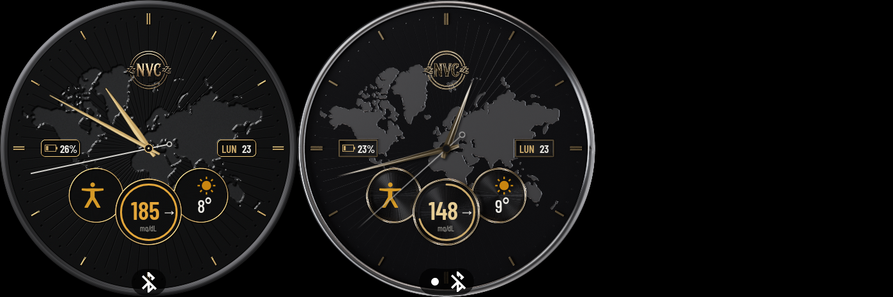

# Prueba 4 · Fondo y agujas renderizados con Blender (2026-11-23)

**Resultado: instalada y funcionando en el reloj** (pantalla activa).

Izquierda: fondo 2D (`art/render_bg.py`). Centro: fondo y agujas de Blender (`scripts/render_3d.sh`).

- Fondo 3D: mapa fresado con paredes, rayos y minutería grabados, sub-esferas hundidas con
  caracoleado, aros y marcos de oro, bisel de acero. La sub-esfera central queda entera por
  encima; los aros laterales terminan contra el suyo.
- Agujas de oro facetadas con sombra: un segundo `AnalogClock` desplazado (2, 3) px con las
  sombras. El reloj lo acepta y lo dibuja sin errores en logcat.
- Primera vez que se ve la glucosa **dentro del rango** en el reloj: 148, aro parcial en oro.

## Pendiente

- **Always-On:** `screencap` en ambiente devuelve la pantalla negra (0 % de píxeles encendidos).
  Puede que el reloj no tenga activada la pantalla siempre encendida o que su modo de reposo lo
  pinte el segundo procesador (en logcat aparece `WatchFaceMcuManager`). Hay que mirarlo a ojo.
- Fluidez y batería con el segundo reloj de sombras (tarea 8).
- El caracoleado cónico de las sub-esferas compite algo con los iconos: valorar en el reloj.
