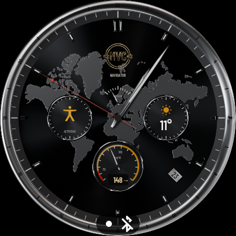
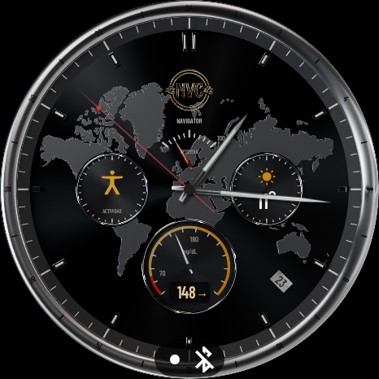

# Prueba 5 · NVC Navigator en el reloj (2026-11-23)

**Resultado: instalada y funcionando** (pantalla activa), junto a la NVC (paquetes distintos:
`com.nvc.watchface.debug` y `com.nvc.navigator.debug`; se elige en el selector del reloj).



- **`Transform target="angle"` sobre una `PartImage` con el valor de una complicación funciona**
  (riesgo 1 del diseño): la aguja del manómetro marca 148 (−23°) y la de la reserva el 23 % de
  batería (−27°).
- Las agujas pequeñas de acero pulido se perdían sobre la esfera; pasan a blanco lacado, como en
  un instrumento de avión.
- Fecha girada 45° en la ventana de las 4:30: se lee.
- Glucosa en rango (148→) en oro; tiempo 11° con icono; actividad con icono en oro.

## Versión 2: glucosa y reserva más grandes



Manómetro r 56 con ventana 44×20 y número de 20 px; reserva r 34–43. **Batería baja comprobada:**
con el reloj al 20 % la aguja de la reserva sale en rojo (`BATTERY_IS_LOW`).

## Cómo se reconstruye

```
scripts/render_3d.sh 256 navigator     # Blender: fondo, agujas, sombras, ambiente
python -I scripts/gen_navigator_xml.py # XML con las medidas de las agujas renderizadas
FACE=navigator scripts/watch.sh <serial> all <captura>
```

## Pendiente

- Casos de glucosa con el proveedor falso (hipo en rojo, hiper en ámbar, sin dato, extremos).
- Always-On: a ojo, como en la NVC.
- Fluidez y batería.
