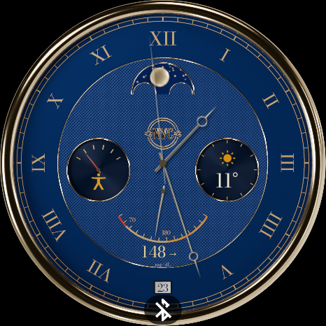
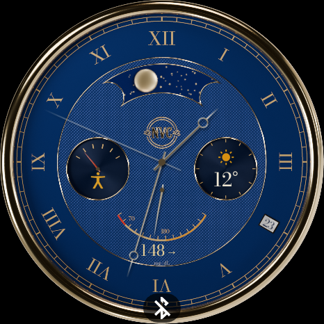
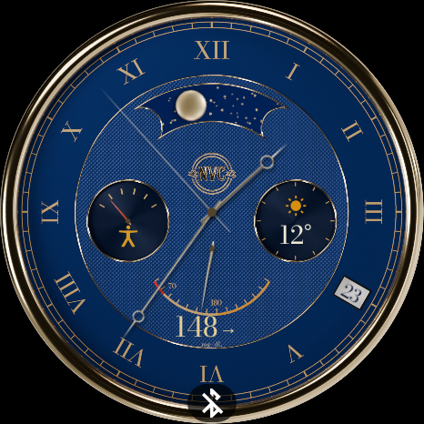
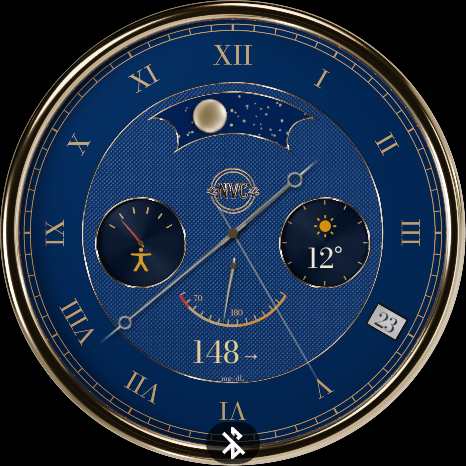

# Prueba 6 · NVC Nocturne en el reloj (2026-11-23)

**Resultado: instalada y funcionando** (pantalla activa), junto a la NVC y la Navigator
(`com.nvc.nocturne.debug`).


- **Fase lunar real:** el disco con dos lunas gira con `[MOON_PHASE_POSITION]` detrás de la
  apertura. El reloj **respeta el alfa del PNG de fondo** (riesgo 1 del diseño): el disco se ve
  por el hueco. Simulación previa en el PC: en luna nueva las jorobas tapan las dos lunas; en
  luna llena una queda centrada.
- **Glucosa:** la aguja azulada no se veía sobre el azul (riesgo 2); pasa a oro pulido y se lee.
  148→ en oro; el número sube 6 px para no pisar «mg/dL».
- Reserva de batería en **rojo** (reloj al 20 %, `BATTERY_IS_LOW`).
- Tiempo 11° con icono, fecha 23 en la ventana de las 6, agujas Breguet con sombra.
- Fuente: Bodoni Moda (SIL OFL, `docs/licencias/OFL-BodoniModa.txt`), en lugar de la Bodoni de
  Windows, que no se puede redistribuir.

## Versión 2: contadores y fase lunar más grandes, III y IX



Contadores r 44, ventana lunar r 44 con lunas r 14; vuelven el III y el IX (sólo falta el VI,
donde va la fecha). Aguja de glucosa en oro.

## Versión 3: ventana lunar concéntrica y fecha a las 4



La ventana lunar sigue el borde de la esfera (franja r 100–140, ±40°, jorobas en los extremos) y
el disco gira alrededor del centro del reloj; simulado en el PC para los días 0, 9, 12, 14,8, 18
y 22 antes de instalar. La fecha pasa a las 4 (girada 30°) porque a las 6 chocaba con el punto
de notificaciones; vuelve el VI.

## Versión 4: fecha y glucosa más grandes



Ventana de fecha 32×22 con número de 20 px; valor de glucosa de 30 px y flecha de 20.

## Versión 5: abanico compactado



Con el valor a 30 px el número chocaba con el arco y la aguja. El abanico pasa a pivote
(233, 265) y r 62; el valor queda debajo, libre.

## Cómo se reconstruye

```
scripts/render_3d.sh 256 nocturne
python -I scripts/gen_nocturne_xml.py
FACE=nocturne scripts/watch.sh <serial> all <captura>
```

## Pendiente

- Comprobar la fase lunar a lo largo de días (hoy sólo una posición).
- Casos de glucosa con el proveedor falso; Always-On a ojo; fluidez y batería.
