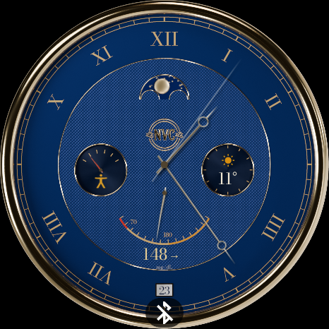

# Prueba 6 · NVC Nocturne en el reloj (2026-11-23)

**Resultado: instalada y funcionando** (pantalla activa), junto a la NVC y la Navigator
(`com.nvc.nocturne.debug`).



- **Fase lunar real:** el disco con dos lunas gira con `[MOON_PHASE_POSITION]` detrás de la
  apertura. El reloj **respeta el alfa del PNG de fondo** (riesgo 1 del diseño): el disco se ve
  por el hueco. Simulación previa en el PC: en luna nueva las jorobas tapan las dos lunas; en
  luna llena una queda centrada.
- **Glucosa:** la aguja azulada no se veía sobre el azul (riesgo 2); pasa a oro pulido y se lee.
  148→ en oro; el número sube 6 px para no pisar «mg/dL».
- Reserva de batería en **rojo** (reloj al 20 %, `BATTERY_IS_LOW`).
- Tiempo 11° con icono, fecha 23 en la ventana de las 6, agujas Breguet con sombra.
- Fuente: Bodoni Moda (SIL OFL, `docs/licencias/OFL-BodoniModa.txt`), en lugar de la Bodoni de
  Windows, que no se puede redistribuir.

## Cómo se reconstruye

```
scripts/render_3d.sh 256 nocturne
python -I scripts/gen_nocturne_xml.py
FACE=nocturne scripts/watch.sh <serial> all <captura>
```

## Pendiente

- Comprobar la fase lunar a lo largo de días (hoy sólo una posición).
- Casos de glucosa con el proveedor falso; Always-On a ojo; fluidez y batería.
